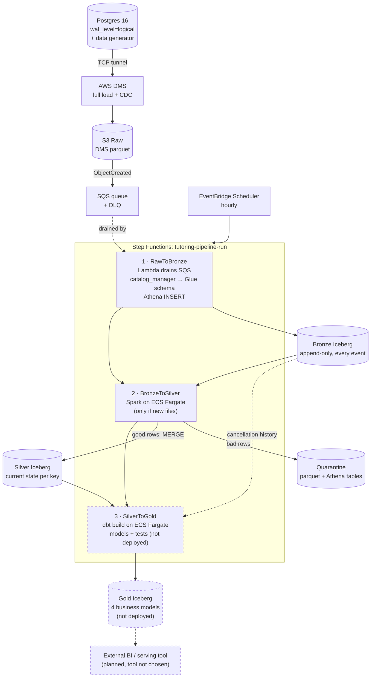

# Tutoring Platform CDC Pipeline on AWS

An end-to-end **change data capture (CDC) lakehouse** on AWS, built entirely with
**Terraform**. Every insert, update and hard delete in an online tutoring
platform's Postgres database is streamed by **AWS DMS** into S3, loaded into an
append-only **Apache Iceberg** Bronze layer, then deduplicated, validated and
**MERGEd** into Silver by a **PySpark** job on **ECS Fargate**. Bad rows go to a
queryable quarantine instead of silently disappearing.

`terraform apply` builds the whole platform (including the Docker images);
`terraform destroy` removes all of it. All data is fake (generated with Faker).


> **Status (2026-11-24):** Source → Raw → Bronze → Silver + quarantine +
> orchestration run end to end on AWS. The first full run succeeded and
> quarantined exactly the 6 injected bad rows. **Gold layer (dbt-athena on
> ECS Fargate) is written and validated (2026-11-25) but not deployed yet.**

---

## The business problem

Students book 1:1 English classes with teachers. The business wants four answers
from the data (the Gold layer):

| # | Question | Needs |
|---|---|---|
| 1 | **Teacher utilization**: completed vs. booked classes per teacher per week | booking status history |
| 2 | **Cancellation & no-show rate** by teacher and by cancel reason | cancelled bookings, which the app **hard-deletes** |
| 3 | **Net revenue per student**: purchases minus refunds | payments + refunds linked to purchases |
| 4 | **Referral funnel**: invited → trial → converted / expired | referral state changes |

Question 2 is why this is a CDC pipeline: a daily snapshot never sees a row that
was cancelled and deleted between two snapshots. CDC captures the delete event.

Source tables (Postgres schema `app`): `teachers`, `students`, `class_bookings`,
`payments`, `referrals`.

---

## Architecture



Solid boxes are built and running on AWS; dashed boxes are written in Terraform but not deployed, or still planned.

| Layer | Storage | Contents |
|---|---|---|
| **Raw** | S3, DMS parquet | Exactly what DMS writes: `Op`, `dms_ts`, source columns, `dms_change_seq` |
| **Bronze** | Iceberg (Glue Catalog) | Append-only log of every I/U/D event + `source_file`, `ingested_at` |
| **Silver** | Iceberg (Glue Catalog) | One row per primary key, current state; deletes applied |
| **Quarantine** | S3 parquet + Athena tables | Rejected rows + the names of the failed rules, run id, timestamp |
| **Gold** *(not deployed)* | Iceberg via dbt-athena | The 4 business models, see [Gold layer](#gold-layer-not-deployed-yet) |
| **Serving** *(planned)* | External tool | Gold pushed to a BI / external tool, see [Serving layer](#serving-layer-planned) |

---

## Gold layer (not deployed yet)

A dbt project (`dbt-athena`, `modules/trans_layer/dbt_gold/dbt/`) on top of
`stock_silver`, run by Step Functions as step 3 **SilverToGold** after a good
BronzeToSilver. `dbt build` runs on the smallest Fargate task (0.25 vCPU /
0.5 GB) on the Spark cluster; the SQL itself runs in Athena. Models and tests
run together: a failing test makes dbt exit 1, and the state machine fails the
run (`SilverToGoldFailed`). Gold tables are Iceberg in `stock_gold`, data in
the Gold bucket, **fully rebuilt every run** (CTAS + swap): idempotent, and
late changes or deletes in Silver always show up.

| Model | Grain | Logic | Source |
|---|---|---|---|
| `gold_teacher_utilization_weekly` | teacher × ISO week | booked, completed, cancelled, no-show, `completed / booked` | `int_class_bookings`, Silver `teachers` |
| `gold_cancellation_rates` | teacher × week × reason (`cancel_reason` or `no_show`) | lost classes, how many were hard-deleted, rate vs. all booked | `int_class_bookings` |
| `gold_net_revenue_per_student` | student | purchases − refunds (refund attributed via `refund_of`) | Silver `payments`, `students` |
| `gold_referral_funnel` | referrer × invite month | invited → reached trial → converted / expired, trial and conversion rate | Silver `referrals`, `students` |

**Hard-deleted bookings:** `int_class_bookings` (ephemeral) = live bookings
from Silver **plus** the last Bronze delete event of every booking that is no
longer in Silver. `REPLICA IDENTITY FULL` makes the delete event carry the
whole old row, so status, reason and teacher are known. Counting from Silver
alone would make both the cancellation rate and the booked count too low.

**dbt tests (42):** `unique` + `not_null` on the Silver primary keys (checks
the Spark dedup + MERGE), `relationships` from `refund_of` to `payments` and
from every Gold model to `teachers` / `students`, the grain of each model
(`unique_combination`), `accepted_values` on reasons, rates between 0 and 1,
and singular tests: every booking counted once in Q1 / Q2, Gold net revenue =
Silver purchases − refunds, the funnel only narrows, and every payment is USD
(the build stops instead of summing two currencies).

---

## Serving layer (planned)

The last step streams Gold to an external tool for business users. The tool
hasn't been chosen yet. The selection criteria are a $0 / free tier, reading from
Athena or S3 without an always-on server, and refreshing after each pipeline run.

---

## Tech stack

| Area | Tools |
|---|---|
| Source | PostgreSQL 16 (logical replication), Python + Faker generator, Docker Compose |
| Ingestion | AWS DMS (full load + ongoing CDC), S3 event notifications, SQS + DLQ |
| Processing | AWS Lambda (Python, one container image), Amazon Athena, **PySpark 3.5 on ECS Fargate** |
| Table format | **Apache Iceberg** on S3, AWS Glue Data Catalog |
| Orchestration | AWS Step Functions, EventBridge Scheduler |
| Infrastructure | **Terraform** (one root module + 14 child modules), Amazon ECR, IAM least privilege |
| Testing | pytest on tiny DataFrames, including real Iceberg `MERGE INTO` tests |

---

## Engineering highlights

**Correct CDC semantics**
- **Two updates to the same row in one transaction** get the same commit time.
  The job orders by `dms_ts`, then DMS's `dms_change_seq`, so the last change wins.
- **Hard deletes propagate**: a delete event removes the row from Silver.
- **Out-of-order safety**: MERGE only applies an event that is the same age or
  newer than the Silver row, so an old batch can never overwrite newer data.

**Idempotent at every step**
- Raw → Bronze skips a file whose `source_file` is already in Bronze, and checks
  that the INSERT wrote rows (a 0-row load fails loudly instead of passing).
- Bronze → Silver reads by **Iceberg snapshot window** stored in a control
  table, not by timestamp. Re-running a window produces the same Silver table.
- Quarantine output for a window is overwritten, never appended twice.

**Data quality that doesn't hide bad data**
- Per-table rules written as Spark column expressions (email format, allowed
  statuses, positive amounts, ISO currency, refund links, cancel reason only when
  cancelled). Each failed row carries a `dq_errors` array of rule names.
- A bad latest event **holds** the key at its last good value in Silver instead
  of overwriting it or dropping it.
- Bad rows are queryable in Athena (`stock_quarantine.<table>`), e.g. "which
  rule fails most".

**Schema evolution**
- A `catalog_manager` Lambda reads the schema of each new DMS file and keeps the
  Raw Glue table in sync (no Glue Crawler). New columns are added to Bronze
  (`ALTER TABLE ADD COLUMNS`) and Silver automatically; a changed column **type**
  stops the load on purpose.

**Cost-aware by design (~$0 when idle)**
- No always-on compute: Spark runs as a Fargate task only when new files
  arrived (~$0.005 per run), then exits.
- No NAT gateway (task gets a public IP, egress 443 only), no Glue jobs, no
  crawlers, no EMR, no Kinesis.
- One load at a time through the queue means no Iceberg commit conflicts.

---

## Design decisions and trade-offs

| Decision | Why | Trade-off |
|---|---|---|
| CDC instead of snapshots | Hard deletes and intermediate states are invisible to snapshots | More moving parts (DMS, replication slot) |
| Bronze append-only, MERGE only in Silver | Full event history for replay, audit and SCD2 | Bronze grows with every change |
| Scheduled queue drain instead of one Lambda per file | Serial Iceberg commits, nothing runs when idle | Up to 1 hour latency |
| Spark on ECS Fargate instead of EMR Serverless / Glue | Account EMR vCPU quota is 0; same PySpark code, per-second billing | Single-node Spark (local mode), fine for this volume, not for 100× |
| Own PySpark DQ rules instead of Glue Data Quality | Row-level results, unit-testable, no Glue DPU cost | Rules maintained in code |
| Incremental read by Iceberg snapshot id | Exact, even when two loads commit out of order | Relies on Iceberg metadata |
| Terraform only, no shell scripts | One command up, one command down, reproducible | Image builds inside `terraform apply` are slow the first time |

**At 100× scale I would change:** DMS → MSK/Kinesis streaming, Spark on EMR or
Glue with real executors, partitioned Silver tables, Iceberg compaction and
snapshot expiry jobs, and Step Functions Map state per table.

---

## Repository layout

```
├── main.tf  variables.tf  outputs.tf  providers.tf  versions.tf   root module
├── docs/RUNBOOK.md                 deploy, run, test, troubleshoot (detailed)
└── modules/
    ├── vpc_config/                 VPC + public subnets (no NAT)
    ├── storage/                    S3 raw / bronze / silver / gold / quarantine (+ lifecycle)
    ├── ingestion/
    │   ├── dms/                    replication instance, endpoints, task
    │   └── s3_athena_trigger/      S3 → SQS (+DLQ) → Raw→Bronze Lambda
    ├── trans_layer/
    │   ├── glue_data_catalog/      Glue databases
    │   ├── athena/                 workgroup, Bronze DDL, quarantine tables
    │   ├── lambda_trans/           catalog_manager Lambda (schema discovery)
    │   ├── spark_ecs/              ECR image, ECS cluster + task, IAM
    │   │   └── jobs/
    │   │       ├── transforms.py        pure functions: dedup, DQ, MERGE SQL
    │   │       ├── bronze_to_silver.py  thin job wrapper
    │   │       └── tests/               pytest (15 tests)
    │   └── dbt_gold/               ECR image, dbt Fargate task, IAM
    │       └── dbt/                     dbt-athena project: 4 Gold models + tests
    └── orchestration/pipeline_run/ Step Functions + EventBridge Scheduler
```

The source database (schema, CDC settings, data generator) lives in a separate
folder, `source-stock-data-pipeline/`.

---

## Quick start

Prerequisites: AWS account, Terraform ≥ 1.13, Docker, the source Postgres
running and reachable by DMS.

```bash
export TF_VAR_source_host=<db host>          # no defaults, no secrets in code
export TF_VAR_source_port=<db port>
export TF_VAR_database_password=<password>

terraform init
terraform plan -out tfplan
terraform apply tfplan                       # builds images, pushes to ECR

aws stepfunctions start-execution \
  --state-machine-arn "$(terraform output -raw pipeline_state_machine_arn)"

terraform destroy                            # removes everything, including buckets
```

Start the DMS task after apply, and drop the replication slot on the source
after destroy. Full steps, expected run outcomes and troubleshooting:
[docs/RUNBOOK.md](docs/RUNBOOK.md).

### Run the tests
```bash
cd modules/trans_layer/spark_ecs/jobs
docker build -t spark-job-test:local .
docker run --rm --user root -v "$(pwd)":/src:ro \
  -e ICEBERG_JAR=/usr/local/lib/python3.11/site-packages/pyspark/jars/iceberg-spark-runtime-3.5_2.12-1.6.1.jar \
  --entrypoint bash spark-job-test:local \
  -c "cp -r /src /tmp/t && cd /tmp/t && pip install -q pytest==8.3.3 && python -m pytest -q tests"
```
Covers: double update in one transaction, insert-then-delete, DQ rules per
table, and real Iceberg MERGE (insert / update / delete / bad row held / re-run /
older batch ignored).

---

## Verified result

First end-to-end run on AWS, 2026-11-22: **SUCCEEDED**. A DQ test script made 7
kinds of changes in the source database; the pipeline put exactly the 6
expected bad rows in quarantine with the right rule names (`email_valid`,
`currency_3_letters`, `referee_email_valid`), applied the double update as one
final row, and left no trace of the inserted-then-deleted booking.

---

## Roadmap

- [x] Source DB + generator; DMS full load + CDC to S3
- [x] Raw → Bronze Iceberg (SQS, Lambdas, Athena), schema evolution
- [x] Bronze → Silver Spark job: dedup, DQ, MERGE, quarantine, 15 tests
- [x] Step Functions + hourly schedule; Terraform-only deploy and destroy
- [x] First successful end-to-end run on AWS
- [ ] **Silver → Gold** with dbt-athena: 4 business models + 42 dbt tests (written + validated, not deployed)
- [ ] Stream Gold to a BI / external tool
- [ ] SCD2 `students_history`, CI (pytest on every push), AWS Budget alert
